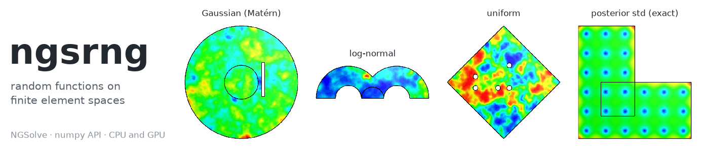
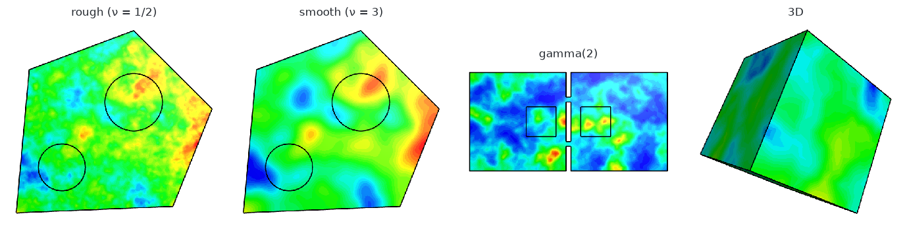
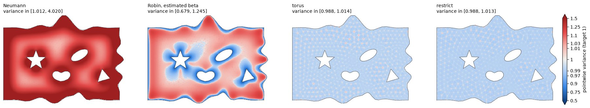

<p align="center">
  
</p>

<p align="center">
  <a href="https://www.python.org"></a>
  <a href="https://ngsolve.org"></a>
  <a href="https://pytorch.org"></a>
  
  <a href="LICENSE"></a>
  <a href="https://github.com/astral-sh/ruff"></a>
  
</p>

<p align="center">
  <b>Random fields on NGSolve finite element spaces, with numpy's sampling API, on CPU and GPU.</b>
</p>

<p align="center">
  <a href="#installation">Installation</a> ·
  <a href="#quick-start">Quick start</a> ·
  <a href="#examples">Examples</a> ·
  <a href="#features">Features</a> ·
  <a href="#good-to-know">Good to know</a> ·
  <a href="#citing">Citing</a>
</p>

---

**ngsrng** draws random *functions*: Gaussian, log-normal, uniform, gamma, Student-t, Wishart and some thirty
other families of random fields, in any [NGSolve](https://ngsolve.org) finite element space. A random function is
not a vector of independent coefficients: the coefficients of a Gaussian field $f\sim\mathcal N(m,\mathcal C)$ have
covariance $M^{-1}K_{\mathcal C}M^{-1}$. ngsrng samples the law of the function, exactly for the chosen mesh and
element order, and builds every other family on it. Each family has several algorithms, and ngsrng picks the fastest
accurate one for your space and hardware.

## Highlights

- **numpy's API.** `rng.normal()`, `rng.uniform()`, `rng.gamma(2.0, size=1000)`, ...: 40 families with numpy's
  names and parameters, plus any `scipy.stats` law. Parameters may vary in space.
- **Exact Gaussian fields.**
  - Matérn priors of any smoothness (SPDE approach).
  - Any PDE or operator precision, and covariances given only as operators.
  - Sparse direct or preconditioned iterative solvers, chosen automatically.
- **Constant variance up to the boundary.** A tuned Robin condition (`boundary="robin", beta=None`), or exactly
  stationary Matérn fields (`boundary="torus" | "restrict"`).
- **Bayesian inverse problems.**
  - Exact posteriors for any finite set of bounded linear observations: point values, local averages, LinearForms,
    and matrix-free maps through an adjoint PDE solve.
  - Low-rank and pathwise (Matheron) updates.
  - Re-weighting for robust noise models.
- **Uncertainty without sampling.**
  - Exact pointwise variance maps $k(x,x)$.
  - Covariance traces (XNysTrace, Hutch++).
  - Sample covariances and Karhunen–Loève expansions.
- **Bounded FE functions.** With `representation="bernstein"` the FE function stays inside the distribution's range
  at every point: a uniform field strictly between 0 and 1, a gamma field positive, a Wishart field positive
  definite.
- **Large batches, fast.**
  - Thousands of samples refilled in place (`out=`, a NumPy array or a torch tensor), threaded on the CPU.
  - On NVIDIA GPUs the solver is cuDSS; on AMD GPUs, AMG-preconditioned CG.
- **Reproducible like torch.**
  - `seed=None` follows `torch.manual_seed`.
  - Samplers pickle and spawn, and DataLoader workers get their own streams.

<p align="center">
  
  <br>
  <sub>Rough (ν = 1/2) and smooth (ν = 3) Matérn fields, a gamma(2) field and a 3D Gaussian field, on the test
  geometries in <code>ngsrng.domains</code> (<a href="docs/assets/make_figures.py">make_figures.py</a>).</sub>
</p>

## Installation

ngsrng needs Python 3.11+, NGSolve 6.2+ and PyTorch 2.6+. Install it with exactly one accelerator extra:

| Extra | Hardware | What it adds |
|---|---|---|
| `cpu` | any | PyTorch's CPU build |
| `cuda` | NVIDIA GPUs | nvmath-python, for the cuDSS sparse direct solver |
| `rocm` | AMD GPUs | pyamg and AMD's ROCm SDK |

```bash
# pip: install PyTorch for your device first (https://pytorch.org/get-started), then
pip install "ngsrng[cuda] @ git+https://github.com/CAarset/ngsrng"

# development, with uv
git clone https://github.com/CAarset/ngsrng && cd ngsrng
uv sync --project env --extra cpu        # or cuda | rocm; add --extra examples for the notebooks
```

`python -m ngsrng.tuning show` reports which extra fits the machine and flags mismatches.

uv projects that depend on ngsrng declare the same three extras. They also copy the torch sources, the indexes and
the conflicts declaration from [env/pyproject.toml](env/pyproject.toml).

## Quick start

```python
import ngsrng                                  # import before ngsolve (see Good to know)
import ngsolve as ngs
import numpy as np

mesh = ngs.Mesh(ngs.unit_square.GenerateMesh(maxh=0.05))
X = ngs.H1(mesh, order=2)
rng = ngsrng.default_rng(X, seed=0, correlation=ngsrng.matern_correlation(0.2, nu=1))  # device="cuda" too

u = rng.normal()                               # one sample: a GridFunction
U = rng.normal(1.0, 0.5, size=100)             # (100, ndof) FE coefficients
k = rng.lognormal(0.0, 0.5, size=10)           # (10, npoints) values at quadrature points
f = rng.uniform(representation="bernstein")    # an FE function with 0 < f(x) < 1 everywhere
g = rng.sample("gamma", 2.0, size=10)          # numpy, scipy and torch.distributions names
rng.info("beta", 2, 5)                         # the law and the algorithms chosen

buf = np.empty((5000, X.ndof), np.float32)     # or a torch tensor, also on the GPU
rng.normal(out=buf)                            # large batches, refilled in place

prior = rng.gaussian()                         # the Gaussian behind the generator
xy = np.random.default_rng(1).uniform(0.1, 0.9, size=(25, 2))   # observation points
y = np.array([u(mesh(*p)) for p in xy])        # data: here, the values of u
post = prior.condition(points=xy, noise=1e-4, data=y)   # exact posterior from point data
var = ngsrng.pointwise_variance(post)          # exact variance map k(x, x), a GridFunction
samples = post.sample(100)                     # (ndof, 100); about one prior sample each
```

## Examples

| Notebook | What it covers |
|---|---|
| [**demo.ipynb**](examples/demo.ipynb)<br>*start here* | Gaussian fields; constant variance up to the boundary; the distributions and their representations; a PDE with a random coefficient; a first inverse problem; low-rank models; covariances given as operators; 1D, curved, DG and 3D settings |
| [**stokes_inverse.ipynb**](examples/stokes_inverse.ipynb) | A 2D linear Bayesian inverse problem: buoyancy inferred from noisy surface velocities of a Stokes flow. Covers a Robin-tuned prior, an adjoint observation operator, exact posterior variance, calibration and predictive checks, and a comparison of designs |
| [**hydraulic_tomography_3d.ipynb**](examples/hydraulic_tomography_3d.ipynb) | A nonlinear 3D inverse problem with heavy-tailed noise: aquifer conductivity from pumping tests. Covers a Gauss–Newton MAP point with re-weighting, the Laplace approximation, and pCN, gpCN and Gibbs MCMC. Runs in about 4 minutes |

The notebooks are stored with their outputs. Interactive views use NGSolve's `Draw`. The static side-by-side panels
use [ngsplot](https://github.com/CAarset/ngsplot), which draws the same pictures with matplotlib.

<p align="center">
  
  <br>
  <sub>Pointwise variance of a Matérn prior (target 1) on an irregular domain, from the demo. Neumann reaches 4,
  and a tuned Robin condition stays within [0.68, 1.25]. The stationary torus and restrict fields are constant to
  within 1.4%.</sub>
</p>

## Features

| Family | Algorithms (chosen automatically) | Accuracy | Cost per sample |
|---|---|---|---|
| Gaussian: Matérn with integer power, any PDE precision | FE white noise and a sparse direct solve (Cholesky, UMFPACK, PARDISO; cuDSS on GPU), or preconditioned CG (BDDC, AMG) | exact (CG: 1e-8) | reference |
| Gaussian: fractional power, or a precision given only as an operator | rational approximation, multi-shift CG | relative 1e-7 | 7–25 solves |
| Gaussian: a covariance given only as an operator | adaptive truncated KL expansion | misses at most `tol` (1%) of the variance | cheap after set-up |
| Gaussian posterior | low-rank update, randomised low rank, pathwise (Matheron) | exact (randomised: approximate) | ≈ 1× |
| uniform, log-normal, exponential, Weibull, Laplace, Pareto, Cauchy, ... | closed-form transform of a Gaussian field | exact at every stored point | 1–2× |
| gamma, beta, F, Wald, von Mises, any `scipy.stats` law | quantile lookup table, or the exact quantile | 1e-10, or exact | 1.3–7× |
| Poisson, binomial, Bernoulli, geometric, Zipf, ... | exact lookup table | exact | 1.2–2.7× |
| chi-square, Student-t, Wishart, matrix log-normal, Dirichlet, NIG | sums, scale mixtures, Bartlett and process constructions | exact at every stored point | 1.4–14× |
| non-Gaussian Karhunen–Loève fields | KL modes with uniform, Rademacher, Laplace or any scipy coefficients | covariance exact | one product |

Costs are relative to one Gaussian sample and come from a CPU smoke run, so treat them as indicative. Every
generator reports its choices: `rng.info(...)` and `Gaussian(...).plan`.

## Good to know

- **Import ngsrng before NGSolve.** If NGSolve is loaded first, torch's batched CPU matrix products crash. ngsrng
  imports torch first, and warns if the order is wrong.
- **A "uniform field" is uniform at each point.**
  - No random function is uniform as a whole. The value of `rng.uniform()` at any single point is uniform, and
    values at nearby points are correlated.
  - Averages and integrals do not follow the named law.
  - The correlation you set is that of the hidden Gaussian field: the transformed field is slightly less
    correlated.
- **Where values are exact.**
  - Non-Gaussian families return values at the quadrature points (where NGSolve evaluates coefficients when it
    assembles a form), or at the `points=` you pass.
  - `representation="bernstein"` gives an FE function instead. It stays inside the range everywhere and is exact at
    the vertices. In between it is slightly smoothed, and the smoothing vanishes under refinement.
- **Point values need some smoothness.** Matérn ν must be positive for the point-value families.
- **Precision.** Results are float32 by default, but every computation runs in float64. Pass `dtype="float64"` for
  double-precision output.
- **Covariances given only as operators** are sampled by truncated expansions, so their samples are slightly
  smoother than the true field.
- **A `BilinearForm` is a precision, not a covariance.** ngsrng warns if you pass one as a covariance.
- **Stationary Matérn fields** run on the CPU only, for scalar spaces with one element type. Their correlations use
  Euclidean distance, also across holes.
- **Reproducibility.**
  - Same seed on the same machine: identical up to rounding.
  - Across machines, solvers or versions: the same law, but different numbers.
  - Pin `method=`, or set `NGSRNG_TUNING=none`, to freeze the algorithm choices.
- **Alpha software.** The API may still change before 0.1.

## Calibration

ngsrng picks its white-noise sampler and solver from built-in rules. A calibration shipped with the package refines
them; it was measured on an NVIDIA A100 with a 32-thread EPYC CPU. You can measure your own machine with one
command, in the spirit of FFTW's planner:

```bash
python -m ngsrng.calibrate          # about 13 min on an A100 machine; --quick checks the set-up, --large goes to 1e6 dofs
python -m ngsrng.tuning show        # which choices apply on this machine, and why
```

Every candidate algorithm must pass an accuracy check before it can win. On the A100, cuDSS sampled faster than the
best CPU solver by:
- 7–12× at 10⁴ dofs;
- 10–93× at 10⁵ dofs;
- 140× for 3D P1 at 2.6·10⁵ dofs.

## Development

```bash
uv run --project env pytest          # GPU tests are skipped without a usable CUDA device
uvx ruff check .                     # lint (configured in pyproject.toml)
```

Every sampler must have an in-place form (`out=`); [tests/test_inplace.py](tests/test_inplace.py) enforces it.

## Citing

If ngsrng helps your research, please cite it:

```bibtex
@software{ngsrng,
  author  = {Aarset, C.},
  title   = {ngsrng: random functions on finite element spaces},
  year    = {2026},
  version = {0.0.1},
  url     = {https://github.com/CAarset/ngsrng}
}
```

The randomised low-rank algorithms follow [Aarset (2024), Algorithm 2](https://arxiv.org/abs/2410.16590), and
[Halko, Martinsson & Tropp (2011)](https://doi.org/10.1137/090771806).

## License

MIT; see [LICENSE](LICENSE).

ngsrng builds on [NGSolve](https://ngsolve.org), [PyTorch](https://pytorch.org), [SciPy](https://scipy.org),
[NVIDIA cuDSS](https://developer.nvidia.com/cudss) (through
[nvmath-python](https://github.com/NVIDIA/nvmath-python)) and [PyAMG](https://github.com/pyamg/pyamg).
